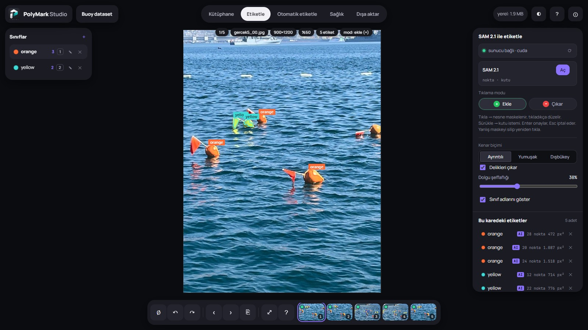
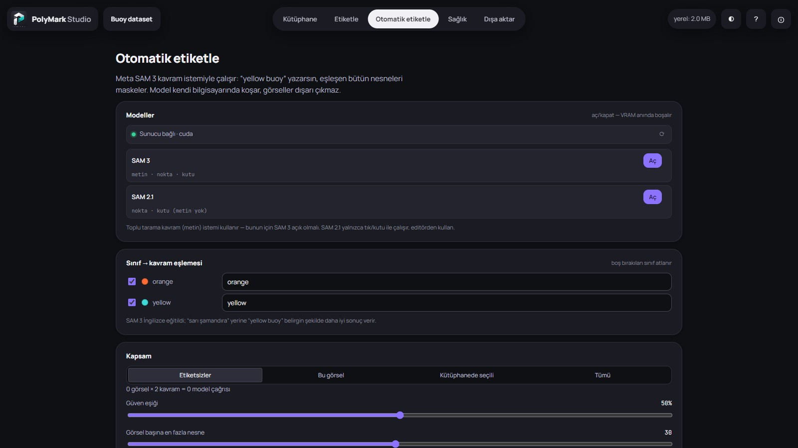
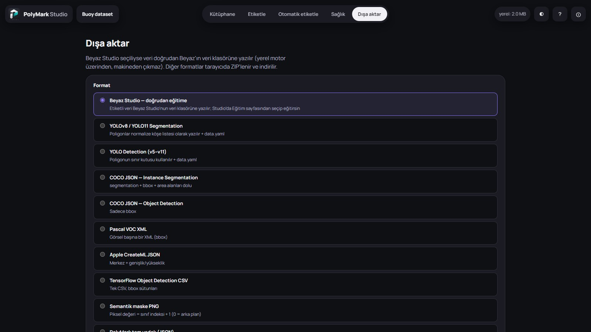
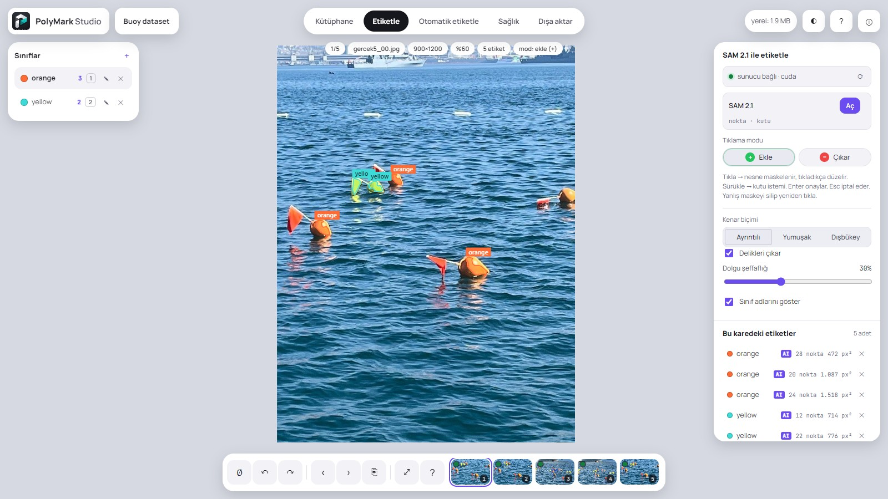

# PolyMark Studio

**A local polygon labeling and dataset creation studio.** Click an object and get a polygon, or describe it in words
and label a whole dataset at once. SAM 2.1 and SAM 3 run on your own GPU: no cloud, no account, no credits, and
images never leave the computer.

> This repository is a project showcase. The software is not distributed publicly.

**Current version: 1.1** — new "floating canvas" interface and one-click export to Beyaz Studio.
See [release notes](#release-notes).

*Demo dataset of buoy photos.*

## Highlights

- **Click-to-polygon labeling with SAM 2.1.** Add or remove points, drag a box prompt and cycle through mask
  candidates with `Tab`.
- **Text-prompt auto-labeling with SAM 3.** Type `yellow buoy` and every matching object in the dataset is masked.
- **Polygons with holes**, for rings, wheels and parts with cut-outs.
- **Augmentation:** flips, rotations, crops, color jitter, blur, noise and cutout. Image and labels are transformed
  by the same matrix, so labels never drift.
- **9 export formats:** YOLOv8-11 segmentation and detection, COCO segmentation and detection, Pascal VOC,
  Apple CreateML, TensorFlow CSV, semantic mask PNG, and a full native backup.
- **Send to Beyaz Studio.** The first export option writes the labeled set straight into Beyaz Studio, the
  author's own from-scratch detector, where it shows up ready to train. Boxes and polygons are both kept.
- **Floating canvas interface.** The image fills the whole window; classes, SAM controls, labels and the film strip
  float on top as cards and the image is fitted between them. Light and dark themes.

## Engineering

- **Frontend:** plain JavaScript with ES modules and no build step. Images live in IndexedDB, with metadata and
  raw blobs in separate stores so a library of thousands of images does not load into memory.
- **Mask-to-polygon pipeline:** Moore contour tracing, Douglas-Peucker simplification with a size-aware tolerance,
  and hole extraction. Compared with the model's raw mask: 0.9 % area difference, 1 px bounding-box difference.
- **AI engine:** a local Python server built on Hugging Face `transformers` loads and unloads SAM 2.1, SAM 3 and
  Beyaz on demand.
- **Measured on an RTX 4070 Laptop GPU (8 GB):**

| Model | VRAM | Inference |
|---|---|---|
| SAM 2.1 | 0.43 GB | ~0.5 s per click |
| SAM 3 | 2.7 GB | ~0.4 s per text prompt once warm |
| Both loaded | 3.2 GB total | — |

- **Beyaz export:** files go through the local engine into Beyaz Studio's data folder. The class list is written
  last, so a half-finished export never appears in Beyaz Studio, and a failed export is cleaned up. Without the
  engine, the same layout is downloaded as a ZIP.
- **Desktop app:** a C# launcher serves the UI and starts the bundled engine without a console window.

## Release notes

### 1.1 (November 2026)
- New "floating canvas" interface: the canvas fills the window and the toolbars, class list, SAM panel and film
  strip float as cards around the image. New color tokens and the Manrope typeface; on narrow windows the cards
  return to a normal layout.
- The image is refitted when the window is resized, unless you have zoomed in yourself.
- **Export > Beyaz Studio** (new default format) replaces the old "Train with Beyaz" tab: one click sends the
  dataset to Beyaz Studio, which picks it up live.
- New logo, favicon and app icons.

### 1.0 (October 2026)
- First desktop release: SAM 2.1 click labeling, SAM 3 text-prompt auto-labeling, augmentation, 9 export formats
  and the bundled local AI engine.

## Author

© 2026 Ayberk KOCABUĞA. All rights reserved.
SAM 2.1 and SAM 3 are models by Meta, used under their respective licenses.
